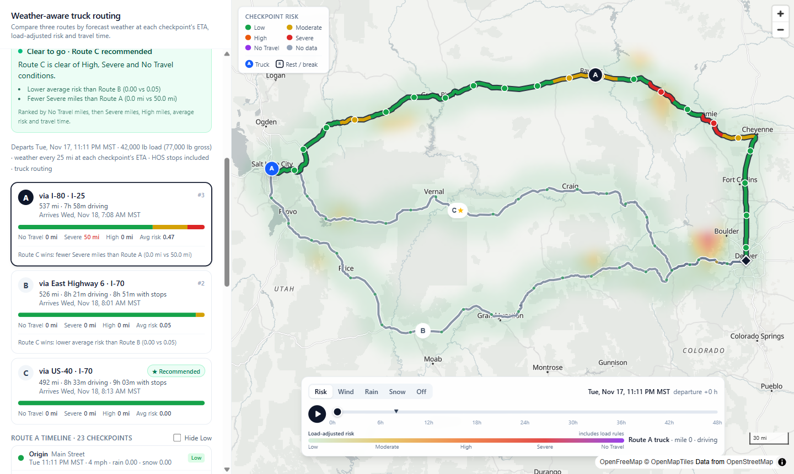
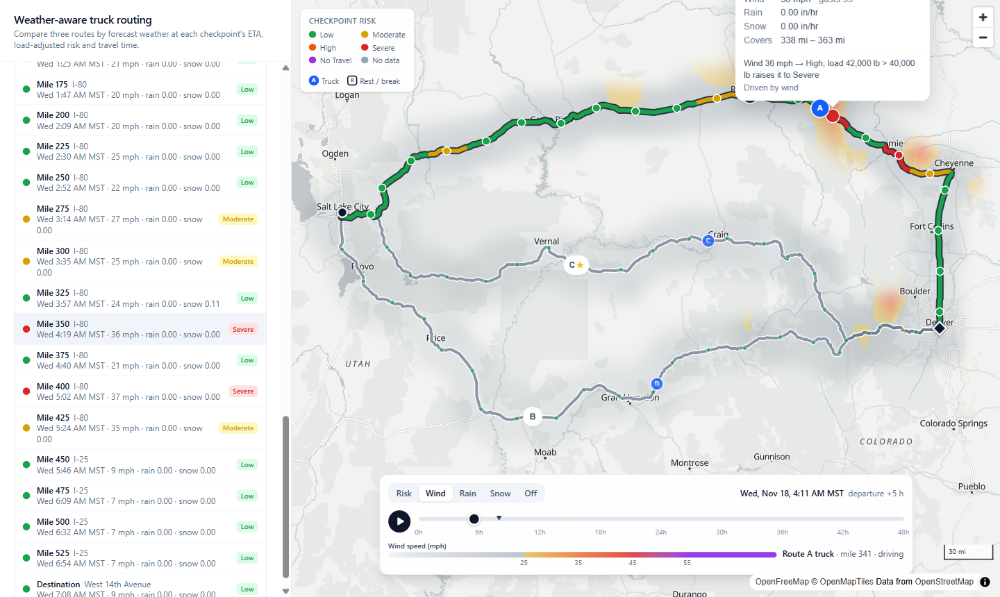

# Weather-Aware Truck Routing

A React + Django app that helps a truck driver choose the safest route. It compares **three
route options** by the **forecast weather the truck will actually meet** at each checkpoint
(at its ETA, including mandatory rest stops), applies the **load-weight risk rules**, and
recommends the best route by weather risk first, then travel time. A **corridor heat map**
with a **0–48 h forecast slider** shows how the weather evolves while the trucks move.

> **Live demo:** <https://weather-aware-truck-routing-delta-six.vercel.app> ·
> **API docs:** <https://wx-truck-routing-api.onrender.com/api/docs> ·
> **Walkthrough (Loom):** <https://www.loom.com/share/af66e44b739c45d9b70aef482d7fe304>





---

## Contents

1. [Quick start](#quick-start)
2. [How it works](#how-it-works)
3. [Edge cases handled (and why they matter)](#edge-cases-handled)
4. [Architecture](#architecture)
5. [API](#api)
6. [Configuration](#configuration)
7. [Testing & quality](#testing--quality)
8. [Deployment](#deployment)
9. [Performance & scalability](#performance--scalability)
10. [Assumptions & limitations](#assumptions--limitations)

---

## Quick start

Requirements: Python 3.11+, Node 22. No API keys are needed: every
third-party service used has a free, key-less tier.

```bash
# 1. API (http://127.0.0.1:8000)
cd backend
python -m venv .venv
.venv/bin/pip install -r requirements/dev.txt        # Windows: .venv\Scripts\pip
.venv/bin/python manage.py runserver

# 2. Web app (http://localhost:5173; proxies /api to :8000)
cd frontend
npm install
npm run dev
```

Pick one of the example trips (e.g. **Salt Lake City → Denver**: I-80 across Wyoming is
often windy enough to trigger the load rules) and press **Plan routes**.

Interactive API docs: <http://127.0.0.1:8000/api/docs>.

---

## How it works

```
origin, destination, departure, load, interval
   │
   ▼
1. Routes ─────── Valhalla `truck` costing (gross weight = load + tare), 3 distinct options
   │
   ▼
2. ETAs ──────── per-maneuver drive time + FMCSA hours-of-service stops
   │
   ▼
3. Checkpoints ── mile 0, every 10/25/50 mi, destination; each owns the road nearest to it
   │
   ▼
4. Weather ────── Open-Meteo hourly forecast sampled at each checkpoint's ETA
   │
   ▼
5. Risk ───────── wind/rain/snow bands + load rules → worst condition per checkpoint
   │
   ▼
6. Ranking ────── No Travel mi → Severe mi → High mi → average risk → travel time
   │
   ▼
7. Heat map ───── corridor grid × 49 hourly frames, loaded right after the plan
```

**1. Three route options.** Valhalla's truck model accounts for truck speeds and restrictions and
receives the vehicle's gross weight (load + configurable tare). Engines often return fewer
alternatives than asked for (OSRM routinely returns 1–2), so missing options are generated
by forcing the route through via points offset perpendicular to the trip axis. A candidate is
accepted only if it is not a big detour (≤ 1.5× the fastest drive time *or* ≤ +45 min, so
short trips still get alternatives) and shares < 80 % of its length with every accepted route.
If the truck router is unavailable (or the trip exceeds its 1,500 km public-server limit), the
app falls back to OSRM with truck speeds capped at 65 mph, and says so. One provider serves
all options of a plan, so truck and car timings are never compared.

**2. Truck ETAs.** Drive time is distributed along the geometry per maneuver (slow city
streets vs. fast interstates) instead of using one average speed. Then **hours-of-service**
stops are inserted: a 30-min break after 8 h of driving and a 10-h rest after 11 h. A 15.75 h
Denver → Chicago drive arrives about 26 h after departure, and every checkpoint after the
first rest is sampled about 10 h later than a naive ETA would. The toggle in the form shows
the difference.

**3. Checkpoints.** At mile 0, every *N* miles and at the destination. A regular checkpoint
within 1 mile of the destination is dropped to avoid duplicate markers. Each checkpoint covers
the stretch closer to it than to any other (midpoint rule), so the per-level miles of a route
always sum to its length.

**4. Weather at the ETA.** Open-Meteo hourly data, requested in mph and inches:

- **rain = `rain` + `showers`** (liquid only). `precipitation` would count snowfall's water
  equivalent as rain.
- **snow = `snowfall`** in inches of snow per hour, which is what the snow thresholds mean.
- **Time alignment:** precipitation values are totals for the *preceding* hour, so an instant
  *t* uses the bucket labelled `ceil(t)`. Wind is instantaneous and is interpolated between
  hours.

**5. Risk.** Each condition is classified by the table. The load rules escalate the wind level
(45–54 mph and > 30,000 lb → No Travel; 35–44 mph and > 40,000 lb → Severe; ≥ 55 mph is No
Travel for any load). The checkpoint level is the worst of wind, rain and snow, and the
reasons are returned for the UI, e.g. *"Wind 47 mph → Severe; load 42,000 lb > 30,000 lb raises
it to No Travel"*.

**6. Recommendation.** Lexicographic, as specified, with two deliberate guards in front:
routes missing forecasts for more than 10 % of their length rank last, and **fewest No Travel
miles** comes first (see [edge cases](#edge-cases-handled)). Missing data is never read as
"safe". Average risk is
distance-weighted (Low = 0 … No Travel = 4). Travel time is wall-clock time including
mandatory stops. The response says *why* each other route lost, e.g. *"Fewer Severe miles than
Route A (0.0 mi vs 50.0 mi)"*. Status is `clear`, `caution`, `no_safe_route` (suggests delaying)
or `insufficient_data`.

**7. Heat map.** The backend builds a grid over a buffer around all routes. Rows are spaced
evenly in *Web-Mercator* Y so the grid maps linearly onto the map. The cell size adapts so the
corridor needs ≤ 220 forecast locations. The browser receives 49+ hourly frames once, then
paints frames into a small canvas that MapLibre draws as a raster layer:

- values are interpolated between hours (smooth scrubbing), upsampled bilinearly in value
  space and coloured through a lookup table;
- the band is clipped to a soft mask stroked from the actual route lines;
- slider and play updates bypass React, so a repaint takes about 1 ms and the map is not
  re-rendered.

Layers: load-adjusted **risk**, **wind**, **rain** and **snow**. Each ramp is anchored on the
backend's thresholds, so "orange" always means the High band. The trucks' positions at the
selected hour (driving, on break, resting, arrived) are drawn on top.

---

## Edge cases handled

| # | Edge case | Naive behaviour | What this app does |
|---|---|---|---|
| 1 | Router returns < 3 routes, or near-duplicates | Shows 1–2 routes | Forced via-point alternatives, de-duplicated by geometric overlap, detours capped; explains when fewer than 3 truly exist |
| 2 | "Fewest Severe miles" vs No Travel | A route with 50 No Travel miles beats one with 10 Severe miles | No Travel miles are compared first; if every route crosses No Travel, status `no_safe_route` with advice to delay |
| 3 | Truck drivers must rest | ETA = drive time, weather sampled hours too early | FMCSA 30-min break / 10-h rest inserted; rest stops shown on the map and timeline |
| 4 | Precipitation semantics | `precipitation` used as rain; hour bucket misaligned | Liquid rain only; snowfall in in/hr; preceding-hour buckets aligned to the ETA |
| 5 | Departure time zone | Browser or server zone used | A naive time is wall-clock time **at the origin** (IANA zone shown); each ETA is displayed in its checkpoint's local zone |
| 6 | Shared or integer band edges (0.25 in/hr, 34.6 mph) | Gaps or double counting | Each band starts at its lower bound (ties go to the more severe band); strict `> 1.00` / `> 3.0` honoured |
| 7 | Load rule thresholds | `>=` vs `>` confusion | Strictly greater than 30,000 / 40,000 lb, as written; tested at the boundaries |
| 8 | Float noise in ranking | 12.5 vs 12.500001 Severe miles decides | Every criterion is quantised with a tolerance, so ordering is stable and transitive |
| 9 | Heat-map correctness | KDE heat map shows sample *density*, not weather | Value raster on a regular grid; Mercator-even rows; soft corridor mask |
| 10 | Weather API quotas | Hundreds of single-point calls per plan | Lattice snapping, per-day caching, batched multi-location requests, parallelism, per-batch degradation |
| 11 | Partial or total weather outage | Missing miles count as 0 Severe/High, so a route with *no data* "wins" | Missing checkpoints are "No data"; a route missing > 10 % of its forecast ranks last, small gaps downgrade "clear" to "caution", a total outage is a 503; never a false "all clear" |
| 12 | Forecast horizon / far departures | Garbage or crashes | Departure limited to now … +7 days; checkpoints beyond the horizon flagged |
| 13 | Truck router distance cap / outage | Error | Falls back to OSRM (car + truck speed cap), labelled in the plan |
| 14 | Unroutable via points (lakes, mountains) | Error | Skipped individually |
| 15 | Same / tiny origin–destination, huge trips | Undefined | Validation with clear messages (≥ 1 mile apart; checkpoint budget per route) |
| 16 | Overweight loads | Ignored | Gross weight sent to the router; warning above 80,000 lb gross |
| 17 | Wind gusts vs sustained wind | Implicit | `WIND_BASIS=sustained` by default (literal spec); `gust` is one setting away; gusts are always shown |
| 18 | `"NaN"` / `"Infinity"` in JSON numbers | DRF accepts them and NaN slips past min/max checks (500s, load rules silently skipped) | Every numeric field rejects non-finite values with a 400 |
| 19 | Displayed values next to their band | 34.96 mph rounds to "35 mph → Moderate" | Values are truncated, never rounded up across a threshold |
| 20 | Platform health checks | Probe uses an internal host and plain HTTP, so Django rejects or redirects it and the deploy fails | `/api/health` is answered by the first middleware, before host validation and HTTPS redirects |
| 21 | Free weather quota on shared hosting IPs | Open-Meteo limits per IP; Render's outbound IPs are shared, so the quota is gone and plans hang on `Retry-After` sleeps | Rate limits fail fast with the provider's reason (never sleep on `Retry-After`), weather and route search have hard deadlines, and weather goes through a Cloudflare Worker, which Open-Meteo meters per account |

---

## Architecture

```
weather-aware-truck-routing/
├── backend/                      Django 5.2 + DRF (stateless; no database)
│   ├── config/                   settings (env-driven, 12-factor), urls, wsgi
│   ├── api/                      HTTP layer only
│   │   ├── container.py          composition root: builds services from settings
│   │   ├── serializers.py        request validation
│   │   ├── presenters.py         domain → JSON (units in every key)
│   │   ├── views.py, urls.py     5 endpoints + OpenAPI
│   │   └── exceptions.py         uniform error envelope
│   ├── planner/                  framework-agnostic core (no Django imports)
│   │   ├── domain/               pure rules: risk, hos, checkpoints, recommendation,
│   │   │                         route, corridor, geo, weather sampling
│   │   ├── integrations/         adapters: Valhalla, OSRM, Open-Meteo, Photon/Nominatim,
│   │   │                         time zones, shared HTTP client (pooling, retries, timeouts)
│   │   └── services/             use cases: route options, weather (cache/batch),
│   │                             trip planner, heat map
│   └── tests/                    unit · integrations (HTTP mocked) · services · api
├── frontend/                     React 19 + TypeScript + Vite + MapLibre GL
│   └── src/
│       ├── api/                  typed client, DTOs mirroring the backend, React Query hooks
│       ├── features/
│       │   ├── trip-form/        accessible place autocomplete, departure/load/interval
│       │   ├── results/          recommendation, route cards, checkpoint timeline
│       │   ├── map/              route/risk layers, markers, tooltip, heat-map canvas layer
│       │   └── heatmap/          renderer, colour scales, corridor mask, controls
│       ├── lib/                  geometry, route models, formatting, time zones
│       └── store/                UI state (Zustand)
├── Dockerfile                    one image: built SPA + API on one origin
├── render.yaml                   one-click Render blueprint
└── .github/workflows/ci.yml      lint, format, tests, build
```

Design principles:

- **Dependencies point inwards.** `planner.domain` is pure and deterministic.
  `planner.services` depend on *protocols* (`RoutingProvider`, `WeatherProvider`, `Geocoder`,
  `Cache`), not concrete clients. Django is confined to `api/` and wires everything once in
  `api/container.py`. Adding a provider (e.g. HERE, TomTom truck routing) means one adapter
  class.
- **Single source of truth for rules.** Thresholds, load rules, intervals and HOS limits live
  in the backend. The UI reads them from `GET /api/v1/meta` for its legends, colour ramps and
  hints.
- **Two requests per plan.** `POST /trips/plan` returns routes, checkpoints and the
  recommendation (so the map draws immediately). `POST /trips/heatmap` then fetches the
  corridor frames. Both are stateless, so any instance can serve either.

---

## API

| Method | Path | Purpose |
|---|---|---|
| `GET` | `/api/health` | Liveness |
| `GET` | `/api/v1/meta` | Risk thresholds, load rules, ranking criteria, limits |
| `GET` | `/api/v1/places/search?q=` | Place autocomplete (+ IANA time zone per result) |
| `POST` | `/api/v1/trips/plan` | Routes, checkpoints, risk, recommendation, corridor grid |
| `POST` | `/api/v1/trips/heatmap` | Hourly corridor frames for 0–48 h after departure |

Full request/response examples: [`docs/api.md`](docs/api.md). OpenAPI schema: `/api/schema`,
Swagger UI: `/api/docs`.

Errors share one envelope, `{"error": {"code", "message", "details"}}`, with these statuses:

- `400` validation error
- `422` the trip is impossible (`invalid_trip`, `no_route`)
- `429` throttled
- `503` an upstream service is down (`upstream_unavailable`)

---

## Configuration

Every setting is an environment variable with a working default. The full list is in
[`backend/.env.example`](backend/.env.example). The most relevant:

| Variable | Default | Purpose |
|---|---|---|
| `DJANGO_ENV` | `development` | `production` enforces a secret key, HTTPS redirect and HSTS |
| `ROUTING_PROVIDERS` | `valhalla,osrm` | Provider order; the next is used only when one is unavailable |
| `WIND_BASIS` | `sustained` | Classify wind on `sustained` speed or `gust` |
| `TRUCK_TARE_WEIGHT_LBS` | `35000` | Added to the load to get gross weight for truck routing |
| `REDIS_URL` | – | Shared cache for weather, place search and rate limits across workers and instances (in-process otherwise; a Redis outage only means cache misses) |
| `OPEN_METEO_API_KEY` | – | Switches to Open-Meteo's commercial endpoint and quotas |
| `OPEN_METEO_URL` / `OPEN_METEO_PROXY_KEY` | public API | Route weather calls through the Cloudflare Worker proxy, authenticated by a shared key |
| `HEATMAP_MAX_CELLS` | `220` | Forecast locations per corridor heat map |

Frontend (build time): `VITE_API_BASE_URL` (empty = same origin) and `VITE_MAP_STYLE_URL`
(OpenFreeMap Positron by default; no key needed).

---

## Testing & quality

```bash
cd backend  && pytest && ruff check . && ruff format --check .
cd frontend && npm test && npm run lint && npm run format:check && npm run build
```

- **173 backend tests**, by layer:
  - risk band boundaries and every load-rule edge
  - scalar vs. vectorised classification equivalence on 2,000 random samples
  - HOS schedules, checkpoint generation and coverage
  - ranking (incl. No Travel first, float tolerance, ties)
  - weather time alignment across midnight
  - corridor grid invariants, polyline simplification vs. a reference Douglas-Peucker
  - provider adapters against recorded-shape payloads
  - route-option fallback and de-duplication
  - planner end to end with fakes
  - the HTTP contract (incl. CORS preflight and non-finite input)
  - regressions found by an independent review
- **17 frontend tests** cover polyline decoding, mile/position interpolation, truck state over
  time (driving / break / arrived), heat-map frame interpolation, masking and colour ramps.
- CI runs all of the above on every push.

---

## Deployment

| Part | Hosted on | Configuration |
|---|---|---|
| Frontend (React build) | Vercel | [`frontend/vercel.json`](frontend/vercel.json) |
| API (Django + Gunicorn) | Render | [`render.yaml`](render.yaml) |
| Shared cache (Redis-compatible Key Value) | Render | [`render.yaml`](render.yaml) |
| Weather proxy (Worker) | Cloudflare | [`infra/open-meteo-proxy/worker.js`](infra/open-meteo-proxy/worker.js) |

The frontend reaches the API through `VITE_API_BASE_URL`, and the API accepts the frontend's
origin through `CORS_ALLOWED_ORIGINS`.

---

## Performance & scalability

- **Latency.** Denver → Chicago: about 2–4 s for the plan (truck routing ≈ 2 s, weather in
  parallel batches) and about 1 s for the heat map, much less when cached. A cross-country
  plan (850 checkpoints at 10 mi) computes in ~1 s of CPU once data is cached.
- **Upstream cost is bounded.** Weather points are snapped to a 0.05° lattice and cached per
  (cell, UTC day), so overlapping routes, repeat plans and the heat map share data. Missing
  cells are grouped by date range and fetched as 100-location requests in parallel. The heat
  map is capped at 220 locations.
- **Payload.** Route lines are simplified for display only (vectorised Douglas-Peucker,
  25 m). All computation uses full-resolution geometry. JSON is gzip-compressed (a
  cross-country plan is ~100 KB on the wire; a heat map ~16 KB).
- **Horizontal scaling.** No sessions, no database, and every request is self-contained.
  With `REDIS_URL` set, weather, place search and rate-limit counters are shared by every worker
  and instance (route sets, which can be MB-sized, stay in each process's memory). Per-client throttling
  (`NUM_PROXIES` aware) protects upstream quotas.
- **Frontend.**
  - MapLibre (WebGL) is lazy-loaded in its own chunk; the initial JS is ~97 KB gzipped.
  - Checkpoints are a single GeoJSON circle layer, with hover via feature-state (no
    re-uploads).
  - The heat map repaints imperatively, outside React.
  - Long checkpoint lists use `content-visibility`.

---

## Assumptions & limitations

- **HOS model.** The driver starts with fresh clocks and only drives. Under those assumptions
  the 14-hour window never binds before the 11-hour limit, and the 70 h/8-day cycle is not
  modelled. Toggle HOS off to compare against pure drive time.
- **Load rules as written.** The rules apply to the entered **load** weight. Physically,
  empty high-profile trailers are often *more* at risk of blow-over, but the specified rules
  are implemented as given.
- **Truck routing range.** The public Valhalla server caps truck routes at 1,500 km; longer
  trips use OSRM (car geometry, truck speed cap). Self-hosting Valhalla (or a commercial truck
  router) removes this; it only changes `VALHALLA_URL`.
- **Free-tier APIs.** Open-Meteo, Valhalla, OSRM and Photon are fair-use services. Open-Meteo's
  free quota (10,000 calls/day) is metered per IP, which is why weather goes through the
  Cloudflare Worker (metered per account). Each plan uses roughly 150–400 location-calls, so very
  heavy use can still hit a limit; the app then degrades with explicit warnings.
- **Forecast skill.** Hourly precipitation beyond ~3 days is low-skill. The 7-day departure
  window keeps the whole trip inside the 16-day forecast range.
